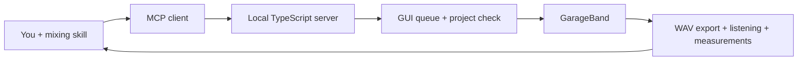

# GarageBand MCP · Mixing Edition

[](https://github.com/usamytch/garageband-mcp/actions/workflows/ci.yml)
[](LICENSE)

**A local MCP server for arranging and mixing in GarageBand, with a source-backed mixing skill for six genre families.**

Fork of [visualfart/garageband-mcp](https://github.com/visualfart/garageband-mcp). It keeps the original MIDI composition tools and adds verified mixer control, guarded GUI operations, region moves, and experimental volume automation. Upstream history and MIT license are preserved.

[Русский](docs/README.ru.md) · [Architecture](docs/architecture.md) · [Mix workflow](docs/mixing-workflow.md) · [61 tools](docs/tools.md) · [Testing](docs/testing.md)

Local editing helpers: [onset analysis and WAV extraction](docs/onset-editing.md), including the verified workaround for the GarageBand timeline-zoom crash. These are optional offline scripts and guarded GUI examples, not additional MCP tools.



## What works—and what is still experimental

| Area | Current scope |
| --- | --- |
| Tracks and mixer | Add/select/delete tracks; explicit mute/solo; pan; actual dB fader readback |
| Smart Controls | Discover controls; set normalized values and switches; reject ambiguous names |
| Regions | Move ordinary audio/MIDI regions by whole bars and between compatible tracks; reject stale IDs and overlaps |
| GUI coordination | FIFO operations within a server; shared macOS user lock across cooperating servers; explicit target project checks |
| Volume automation | **Experimental:** modest phrase rides on an empty visible lane in a stopped 4/4 project copy; requires rendered verification |
| Composition | Original virtual MIDI, chords, scales, sequences, recording, imports, loops and export tools |
| Mixing knowledge | One installable skill with punk, funk, metal, pop, rock and Latin profiles |

**Not implemented:** fractional-bar region moves, a general automation-point editor, arbitrary Audio Unit parameters in Hz/ms/dB, or reliable unattended operation on any macOS/GarageBand version. Normalized Smart Control values are not physical units. The GUI adapter currently expects English GarageBand labels and an unlocked desktop.

## Build and connect

Requirements: macOS, GarageBand with first-run setup completed, Node.js 22 or newer recommended, Python 3 on `PATH`, and Xcode Command Line Tools for the native MIDI dependency. No Python packages are required by the server. Audio verification scripts additionally use FFmpeg/ffprobe.

```sh
git clone https://github.com/usamytch/garageband-mcp.git
cd garageband-mcp
npm ci
npm run check
```

Configure your MCP client to launch `dist/index.js` with your **absolute Node path**. A common client configuration looks like:

```json
{
  "mcpServers": {
    "garageband": {
      "command": "/absolute/path/to/node",
      "args": ["/absolute/path/to/garageband-mcp/dist/index.js"],
      "env": {
        "GARAGEBAND_MCP_DATA_DIR": "/absolute/path/to/MixWorkspace"
      }
    }
  }
}
```

Configuration containers differ between clients; use the same command/args in your client's MCP settings. This fork is installed from source; the upstream npm package does not contain these changes. `private: true` prevents accidental npm publication under the upstream package name.

Grant Accessibility and Automation permissions to the process that macOS identifies as controlling GarageBand. Screenshot-dependent tools also need Screen Recording. Use `gb_check_permissions` and `gb_list_projects` before editing. Save the project, make a working copy, and pass its exact path to project-bound calls:

```json
{
  "name": "gb_set_track_volume_db",
  "arguments": {
    "projectPath": "/absolute/path/to/MixWorkspace/projects/Mix-01.band",
    "trackIndex": 3,
    "db": -8
  }
}
```

Automation evidence defaults to `~/Music/GarageBand MCP/automation/`; set the absolute `GARAGEBAND_MCP_DATA_DIR` to place it in a session folder. Export destinations are explicit tool arguments. The shared GUI lock always stays at `~/Library/Caches/garageband-mcp/gui.lock` so different installations cooperate.

## Install the mixing skill

Copy [skills/mix-engineer](skills/mix-engineer) as a whole into your client's skills directory. For a standard local Codex skills directory, from this repository:

```sh
mkdir -p "$HOME/.codex/skills"
cp -R skills/mix-engineer "$HOME/.codex/skills/"
```

Check for an existing `mix-engineer` installation before replacing it, then reload the client's skill list. Example request:

> Use $mix-engineer to mix a copy of this rock session. Keep my excluded tracks muted. Start with balance, then vocal phrase rides, and compare WAV exports at matched loudness.

Profiles: [punk](skills/mix-engineer/references/genres/punk.md) · [funk](skills/mix-engineer/references/genres/funk.md) · [metal](skills/mix-engineer/references/genres/metal.md) · [pop](skills/mix-engineer/references/genres/pop.md) · [rock](skills/mix-engineer/references/genres/rock.md) · [Latin](skills/mix-engineer/references/genres/latin.md).

The skill supplies decisions and evaluation criteria; MCP supplies concrete actions and readback. Profiles are conditional working hypotheses, not artist presets or endorsements. Sources and access limits are recorded alongside them.

## Validation and contributing

`npm run check` runs behavior tests, type checking, a build, and a real stdio MCP handshake/schema check. CI does not drive GarageBand. [Testing](docs/testing.md) separates simulated, protocol and live-render evidence, and describes disposable fixtures.

See [AGENTS.md](AGENTS.md) for contributor rules. Keep recordings, `.band` bundles, exports, credentials and machine-specific evidence out of Git. The current checkout contains text assets only; upstream preview audio remains in Git history to preserve the fork relationship. Use a shallow clone if download size matters.

[MIT](LICENSE), originally copyright © 2026 visualfart. Fork additions are distributed under the same license. This is an independent community project, not affiliated with Apple or the engineers cited by the mixing profiles.
