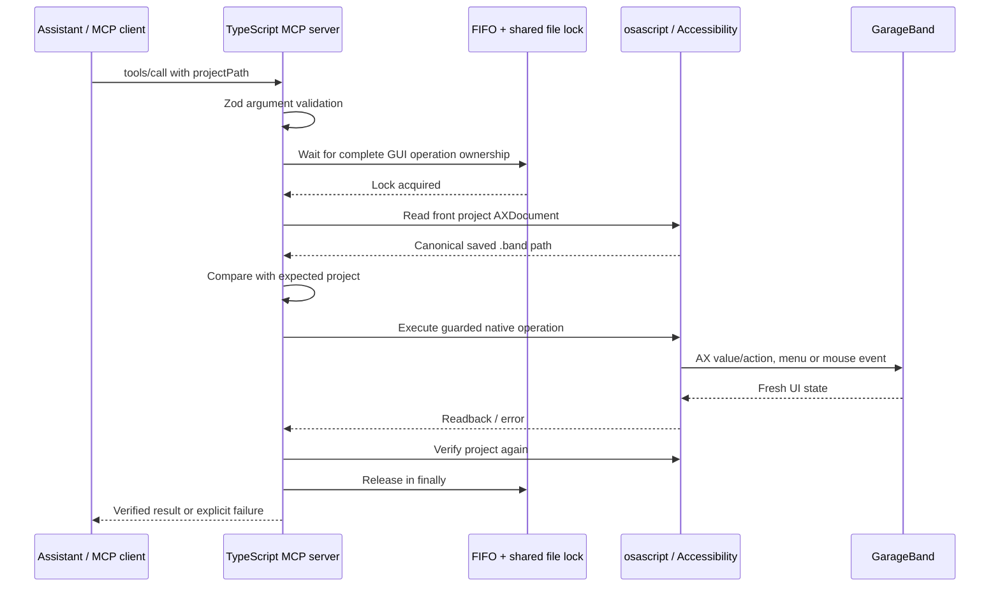
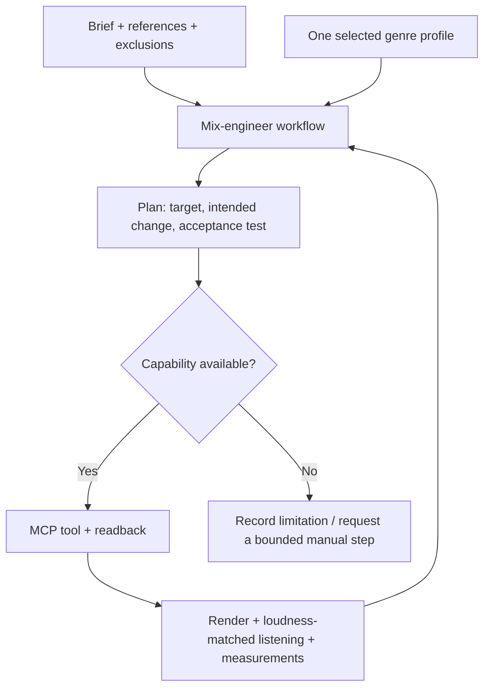

# How the MCP works

MCP is the protocol between an assistant's client and a tool server. The client starts this local Node process and exchanges JSON-RPC over stdin/stdout: initialize, list tools, call a tool, receive text/images/errors. The model chooses actions; the server validates arguments and performs the action. The MCP server runs locally; optional sample search/download tools access external services. GarageBand has no direct access to the model's reasoning.

## Layers and APIs

| Layer | Implementation | Responsibility |
| --- | --- | --- |
| Protocol | TypeScript, `@modelcontextprotocol/sdk`, Zod | Tool discovery, argument validation, cancellation, results |
| Coordination | `gui-queue.ts`, Python standard-library `fcntl.flock` helper | FIFO within one process; mutual exclusion across cooperating processes for this macOS user |
| Target identity | `project-guard.ts`, `operation-context.ts` | Resolve the requested `.band`, read `AXDocument`, reject a different/unknown project before native work |
| Scripting | `osa.ts`, `applescript.ts`, `ui.ts` | Apple Events through `osascript`, basic application/document access, menus and keyboard controls |
| Accessibility | `native-ax.ts`, `track-state.ts`, `region-state.ts`, `smart-state.ts` | JXA Objective-C bridge to ApplicationServices; walk AX elements, inspect values/bounds, set values and actions |
| Mouse gestures | CoreGraphics `CGEventCreateMouseEvent` / `CGEventPost` | Visible region moves and automation gestures where AX does not expose editable values |
| Screenshot inspection | `screencapture`, AppKit bitmap access | Experimental detection of the visible automation line |
| Music | `midi.ts`, `scheduler.ts`, `music.ts`, `smf.ts` | Virtual CoreMIDI output via `easymidi` and its native MIDI dependency; notes, timing, composition and MIDI files |
| Rendering | `tools/export.ts`, `export-file.ts`, `export-settings.ts` | Drive GarageBand's export UI, wait for the output, preserve normalization preferences |

The project itself is TypeScript plus embedded AppleScript/JXA and a small Python lock helper. It does not compile its own C++ GarageBand integration. The native MIDI dependency supplies the compiled bridge to CoreMIDI. GarageBand still renders the instruments, effects and mix.

This is **GUI automation**, not an undocumented GarageBand DSP API or a `.band` file-format editor. Accessibility is a public macOS interface, but GarageBand's element names, nesting and exposed values can change. The adapter depends on observed English UI labels and verified readback. See Apple's [Accessibility API](https://developer.apple.com/documentation/applicationservices/axuielement) and [GarageBand automation guide](https://support.apple.com/guide/garageband/add-and-edit-automation-points-gbnd65471e12/mac).

## Guarantees and boundaries

- All GUI tool handlers enter the queue. Most require `projectPath`; discovery tools do not. Open checks the requested path afterward; close checks before closing.
- The target check runs after waiting, before native scripts, and after successful project-bound work. Native AX helpers also check before actions. A user can still switch windows between a check and an event; this is not an atomic transaction inside GarageBand.
- Five independent operations bypass the GUI queue: MIDI-file parsing/import-cache access, sample search/download, and emergency all-notes-off. They do not perform an ordinary GarageBand GUI edit.
- FIFO order applies inside one server. The shared lock provides mutual exclusion, not global FIFO fairness. Manual mouse/keyboard activity and unrelated automation do not honor it.
- The kernel releases the helper's lock on exit. This is not rollback and does not guarantee a surviving `osascript` child stopped. After a crash or timeout, inspect native activity and the project before retrying.
- Cancellation while queued avoids starting an edit. Cancellation during work holds ownership until the action settles. Partial edits are reported; there is no general undo transaction.
- Automation cannot enumerate all points through AX. An apparently empty visible lane does not prove the entire project has no hidden points. Use a known fresh copy and validate the rendered result.

## Musical knowledge stays above the adapter

A new genre does not need a new MCP command. It needs a profile describing musical goals and conditional decisions. A new DAW needs a different adapter. A program with a documented API is usually easier and more reliable to automate than one requiring screen gestures. MCP can expose either, but does not create capabilities the application lacks.
