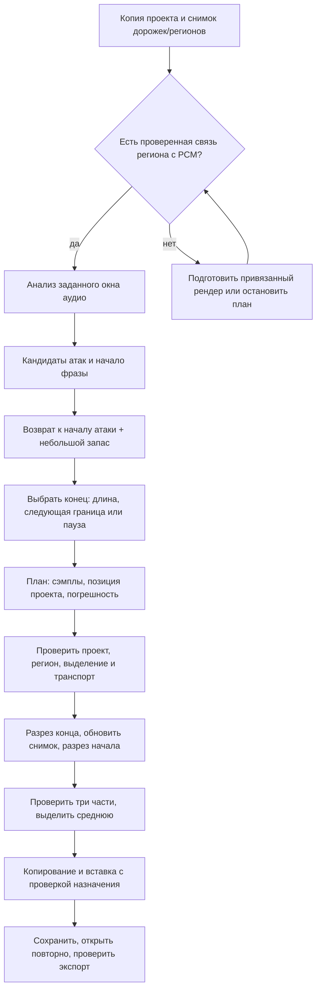

# Выделение фрагментов по атаке

Статус: проект следующего этапа. Детектор, точные разрезы и copy/paste пока не зарегистрированы как команды MCP. Уже доступны чтение дробных границ и явное управление видом автоматизации. Перемещение по-прежнему ограничено целыми тактами.

## Результат для музыканта

Запрос: «На этой гитарной дорожке найди начало риффа около указанного места, выдели четыре такта и скопируй в припев». Агент находит кандидатов в заданном окне, показывает границы и короткое прослушивание, затем создаёт отдельный регион на рабочей копии. Исходный аудиофайл сохраняется. При неоднозначности выбирается кандидат, а не выполняется случайный разрез.

Атака ноты и начало фразы — разные события. Частый бой даст много атак; легато может не дать выраженного пика. Поэтому нужны два режима: **первая атака в окне** и **начало фразы после паузы**. Режим «каждую атаку в отдельный регион» — отдельная, более поздняя возможность.

## Поток данных

## 1. Сначала достоверно получить аудио

Сейчас Accessibility сообщает имя, положение и геометрию региона, но не предоставляет проверенную привязку к исходному медиафайлу, смещение обрезки и карту растяжения. Нельзя угадать исходник по похожему имени файла в пакете `.band`.

Первый поддерживаемый случай — обычный аудиорегион с известным исходником, его контрольной суммой и проверенным соответствием «сэмпл файла → время проекта». Например, специально импортированная тестовая запись с известной позицией. Для существующей записи необходим отдельный шаг привязки: подтверждённые исходник/обрезка либо изолированный рендер дорожки с известным нулём и проверенной задержкой. Временные solo/mute и эффекты рендера записываются и восстанавливаются; Suno и прочие исключения остаются защищёнными.

Рендер со всей обработкой может сдвигать или скрывать атаку. Для монтажа предпочтителен сухой сигнал; нельзя молча считать экспорт через мастер с компрессором или ревербератором эквивалентом исходника. Если сухой экспорт, задержка или связь с выбранным регионом не проверены, выдаётся анализ с ограничениями, но автоматический разрез блокируется.

Хранить целочисленные индексы сэмплов, частоту дискретизации, SHA-256 PCM/файла и описание преобразования. Пересчёт в музыкальную позицию отдельно учитывает темп, размер, обрезку, повторение, растяжение и обратное воспроизведение. Для первой версии допустим только постоянный темп и подтверждённая линейная привязка без Flex, loop, reverse и take folder. Даже при 4/4 нельзя заранее подставлять 960 ticks/quarter: единицы GUI нужно измерить.

## 2. Найти атаку, не срезав её

Предлагаемый алгоритм:

1. Читать только выбранное окно с небольшим контекстом до/после. Оценить шумовой порог и огибающую RMS. Стереоканалы анализировать отдельно, объединяя энергии/оценки; простое сложение каналов может погасить противофазную атаку.
2. Получить spectral flux — рост энергии спектральных полос между соседними кадрами. Совместить его с RMS, адаптивным порогом, гистерезисом и минимальным расстоянием между событиями. Для баса нужны более длинные окна, чем для щелчка медиатора.
3. Найти кандидатов пиков. Для режима фразы потребовать перед кандидатом достаточно длинный тихий участок или объединить последовательность нот в кластер. На перегрузе постоянно высокая энергия; один порог громкости здесь ненадёжен.
4. От кандидата вернуться к предшествующему локальному минимуму энергии, затем уточнить начало по исходным сэмплам. Ограничить глубину поиска, чтобы не перескочить в предыдущую ноту. Такой backtracking рекомендован для выбора границ аудиосегментов в [документации librosa](https://librosa.org/doc/0.11.0/generated/librosa.onset.onset_backtrack.html).
5. Добавить небольшой настраиваемый запас перед началом атаки. Проверить ближайшее безопасное место разреза для обоих каналов. Не переносить границу к дальнему нулю ценой потери начала звука. Если нужна короткая кроссфейд-обработка, использовать её только после реализации и проверки соответствующей команды.

Сохранять время пика, выбранное начало, запас, показатели силы/шума и причины выбора. «Уверенность» сначала означает эвристический рейтинг, а не калиброванную вероятность. При тишине возвращать пустой список. При нескольких похожих кандидатах сохранять варианты и запрашивать выбор, если политика пользователя не определяет его однозначно.

### Конец фрагмента

Одна атака не задаёт конец риффа. План должен явно выбирать:

- **Музыкальную длину**: например, четыре такта от музыкального якоря. Отдельно учитывать запас перед атакой, чтобы он не удлинял петлю и не накапливал сдвиг при повторениях.
- **Следующую выбранную атаку/границу**: полезно для ударов и отдельных нот; хвост может нуждаться в перекрытии.
- **Конец фразы**: спад ниже порога на заданное время плюс хвост. Не обрезать тихое окончание вокала или затухание гитары из-за короткого провала огибающей.
- **Явную позицию**: пользователь уже знает длину нужного участка.

Привязка к сетке — явная опция. По умолчанию найденная атака сохраняется; при квантовании план показывает смещение в миллисекундах. При копировании петли отдельно хранить её музыкальный якорь и границы аудио.

## 3. Команды и исполнение

Предлагаемые команды, пока не реализованы:

| Команда | Назначение и обязательные проверки |
| --- | --- |
| `gb_analyze_onsets` | Анализ локального PCM с подтверждённой привязкой, окно, режим, кандидаты и диагностические фрагменты. Не меняет GarageBand. |
| `gb_plan_region_extract` | ID и отпечаток региона, начало/конец в сэмплах, позиции GUI, допустимая погрешность, политика хвоста/сетки. Возвращает план и причины блокировки. |
| `gb_extract_region` | Проверяет актуальность плана, выделяет ровно исходный регион, выполняет разрезы и выделяет результат. Возвращает новые ID и журнал завершённых шагов. |
| `gb_copy_region_to` | Одна последовательность copy/paste под GUI-замком: проверка источника, дорожки назначения, совместимости, позиции, отсутствия перекрытия и новой вставки. Возвращает ID копии. |

Анализ можно вынести в локальный Python-процесс с закреплёнными версиями NumPy/librosa и JSON-протоколом. Основной MCP остаётся TypeScript. Сначала отдельный воспроизводимый офлайн-прототип; зависимость добавлять после оценки точности на тестах. PCM и результаты остаются локально. Ключ кэша: hash входа + параметры + версия алгоритма. Анализ ограничен по памяти/времени, поддерживает отмену и не держит GUI-замок. GUI-команды продолжают использовать существующую общую очередь и проверку проекта; анализ не даёт разрешения применить устаревший план.

Критический предшественник — **точное позиционирование курсора с чтением результата**. Apple документирует двойной щелчок по LCD с вводом позиции и последующее редактирование отдельных единиц. Это перспективный способ, но его ещё нужно проверить через Accessibility и экспорт. Существующая запись `AXValue` в проверенных контролах может давать один шаг, а не устанавливать абсолютное значение. [Перемещение курсора в GarageBand](https://support.apple.com/guide/garageband/move-the-playhead-gbnd912c61f4/mac).

Разрезать сначала конец, затем начало, каждый раз перечитывая регионы и обновляя ID. Если граница совпадает с краем, разрез не нужен. Для двух внутренних границ ожидаются три смежных региона, их общее покрытие совпадает с исходным; все остальные регионы неизменны. Проверка единственного выделения обязательна: GarageBand разрезает все выделенные регионы под курсором. MIDI исключён из первого этапа из-за поведения нот и возможных диалогов. [Разрезы в GarageBand](https://support.apple.com/guide/garageband/split-regions-gbnd76fcce04/mac).

Копировать через проверенное меню, с фокусом в Tracks. Имя копии может получить числовой суффикс; оно не доказывает идентичность содержимого. Проверять новое расположение, длину, количество регионов и аудио. Copy/paste внутри одной команды уменьшает риск подмены буфера между вызовами, но не изолирует буфер от пользователя и других программ. [Копирование и вставка в GarageBand](https://support.apple.com/guide/garageband/cut-copy-and-paste-regions-gbnd1150b44a/mac).

Отдельная политика нужна для автоматизации и эффектов: копирование аудиорегиона не гарантирует тот же звук на другой дорожке или под другой частью кривой громкости. Первый монтажный тест должен использовать свежую дорожку без автоматизации и обработки. Для реального вокала план явно выбирает перенос сухого материала либо подготовленного рендера с обработкой; перенос самих точек автоматизации требует отдельной проверенной команды. Пока MCP не умеет достоверно перечислять точки, нельзя обещать их сохранение при переносе регионов или проверять это одним снимком экрана.

Перед каждым изменением: тот же проект, точное имя/индекс дорожки и отпечаток региона, остановленный транспорт, ожидаемое выделение, корректный Snap и вид автоматизации. После частичного сбоя остановиться, сохранить журнал и перечитать состояние. Не обещать транзакцию и не отправлять несколько Undo вслепую. Надёжное восстановление — из подготовленной копии.

## 4. Проверки и порядок реализации

| Этап | Условие готовности |
| --- | --- |
| Точная позиция | Seek в начало, середину и конец проекта; доли/деления/тики; тесты при разных темпах/размерах. Фактическая погрешность измерена, повторный вызов не двигает позицию. |
| Split/copy | Синтетический PCM с известными импульсами и маркерами. Ровно нужные разрезы, другие дорожки неизменны, вставка на нужную дорожку. Save/reopen сохраняет результат. |
| Детектор | Размеченные атаки чистой и перегруженной гитары, баса, вокала и ударных; тихий сигнал, шум, тишина, стерео с противофазой, атака на краю окна, соседние атаки и легато. Отдельно измерять пропуски, ложные события и ошибку времени. |
| Полный сценарий | Проверенная привязка источника к региону → найденная атака → извлечение → вставка. Экспорт подтверждает положение и сохранность атаки; защищённые дорожки остаются выключенными. |

Точность GUI измеряется отдельно от точности детектора. Сэмпловый индекс кандидата сам по себе не делает разрез sample-accurate. Начальный ориентир для сухой тестовой записи — ошибка до нескольких миллисекунд, но окончательный допуск выбирается после измерения GUI и музыкального материала; для фазосвязанных микрофонов нужен существенно более строгий режим.

Контрольный экспорт после одного разрезания без переноса должен совпадать с исходным сухим сигналом. После вставки сравнивать содержимое с учётом известного смещения. Простое вычитание двух полных миксов через нелинейные/случайные эффекты не является достаточным тестом. Полный микс дополнительно проверяется на клиппинг, щелчки и прослушивается.

Для каждого запуска сохранять в локальном каталоге задачи: план, снимки до/после, hash источника, таблицу кандидатов, небольшой график огибающей, короткие WAV до/после, журнал GUI-шагов и результаты проверки экспорта. Полные промежуточные рендеры хранить только если они нужны для воспроизведения или сравнения. В Git входят код, синтетические тесты и документация, а не пользовательская музыка.
