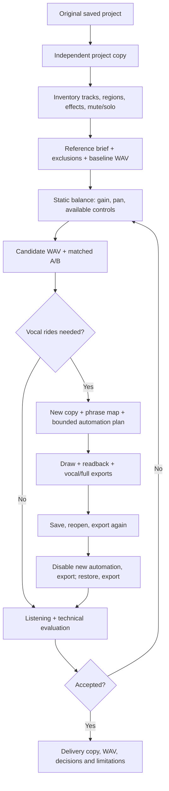

# Creating a mix and keeping it reviewable

The process separates the project, the musical decisions and the proof that edits reached the rendered audio. The installable [mix-engineer skill](../skills/mix-engineer/SKILL.md) contains the operating instructions; this document explains the artifacts.



## What is changed

Start with the complete session copy, retaining media dependencies. A filesystem copy of a `.band` bundle is not proof that externally referenced media was included: verify the copy opens and plays with the required media. Record exactly which project is the target.

Preserve the artist's track exclusions. **Muting is the default for excluded tracks.** Do not delete source tracks or recordings to make the mix look clean. Remove, trim, replace or time-align material only when authorized as an arrangement/editing decision. Original, alternate and reference tracks remain identifiable. Each temporary solo/export operation restores the prior mute/solo state, not a guessed all-on default.

Balance the song in context, then adjust available tone/dynamics controls for a stated audible problem. Read normalized Smart Controls as normalized values. A setting called “Amount” does not establish a compressor ratio or threshold. Track volume in dB uses GarageBand's readback.

Vocal phrase rides come after a stable balance. RMS-based segmentation proposes phrase boundaries; it does not identify lyrics or the musical meaning of breaths. Review the phrase map before drawing. Preserve intentional dynamics and consonants; compare in the full arrangement and in solo. A louder render is not automatically a better mix.

## Session folders

These are runtime artifacts, excluded from Git. Names below are conventions, not files the server automatically creates.

```text
MixWorkspace/
  projects/       Original-copy.band, Mix-01.band, Mix-02.band
  inventory/      tracks-before.json, regions-before.json, controls-before.json
  plans/          brief.json, mix-plan.json, phrase-map.json
  automation/     <operation-id>/before.png, flat.png, after.png,
                                plan.json, progress.json
  exports/        01-baseline.wav, 02-static.wav, 03-vocal-rides.wav,
                  04-reopened.wav, 05-rides-disabled.wav, 06-restored.wav
  analysis/       metrics.json, phrase-gains.json, comparison.json
  journal/        operations.jsonl, decisions.md, evaluation.json
```

The server writes automation evidence automatically to its configured data directory. The assistant/client manages inventories, plans, journals and audio analysis; MCP does not currently provide one command to generate the whole workspace. Do not claim an artifact exists until it is saved.

A journal entry records the target project, stable track description plus current index, previous value, requested value, actual readback, tool result and render used for acceptance. Record partial failures before taking another action. Include application/server version and relevant export settings.

## What each export proves

| Export | Purpose |
| --- | --- |
| Baseline | Existing balance and signal path before changes |
| Static candidate | Gain, pan and tone choices before automation |
| Vocal solo before/after | Phrase gain and timing checks; temporary solo must be restored |
| Full candidate | Whether the edit works musically in context |
| Saved/reopened candidate | Whether automation and mixer settings persist |
| New rides disabled | Whether bypassing only the new curve restores the baseline |
| Restored candidate | Whether restoring the new curve reproduces the candidate |

Match export format, sample rate, length, normalization and master processing for comparisons. Check files are decodable, nonempty, finite, unclipped at the sample level, and contain the expected signal/timing. True-peak and loudness analysis require separate appropriate measurement. Listen at matched loudness, including mono and quiet playback; do not present measurements as a substitute for listening.

A limiter or compressor on the master can change all samples when one vocal changes. Subtracting a solo render from a full mix therefore need not produce an unchanged accompaniment. Prefer controlled full-path bypass/reopen comparisons. Randomized instruments and modulation can also prevent a perfect null; report their limits instead of declaring every residual a bug.

The current MCP does not expose a general automation bypass control. The disable/restore comparison may need a bounded, inspected manual UI step. Do not invent a command or silently alter a different effect.

## Deliverables

Keep the accepted project copy, the final full-resolution export, an evaluation with unresolved issues, and a concise description of track exclusions, actual edits and material left intact. Publish software and generic examples separately from the song and private evidence.
